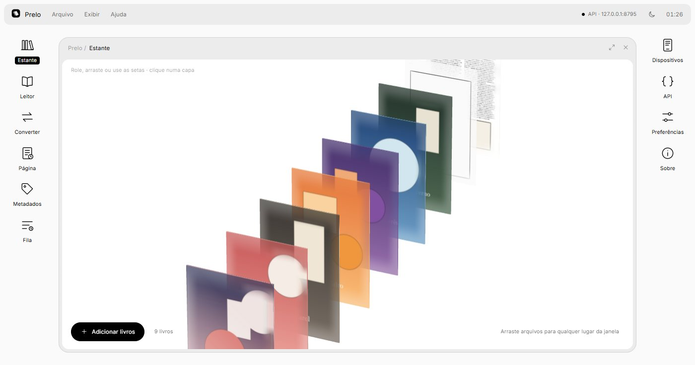
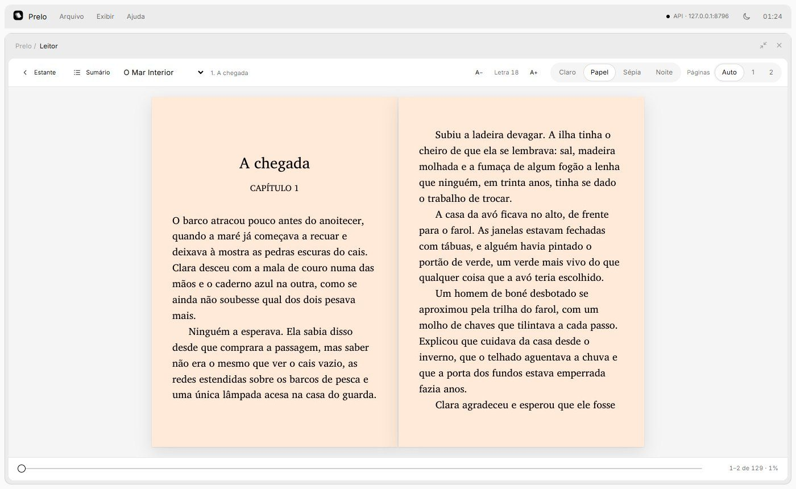
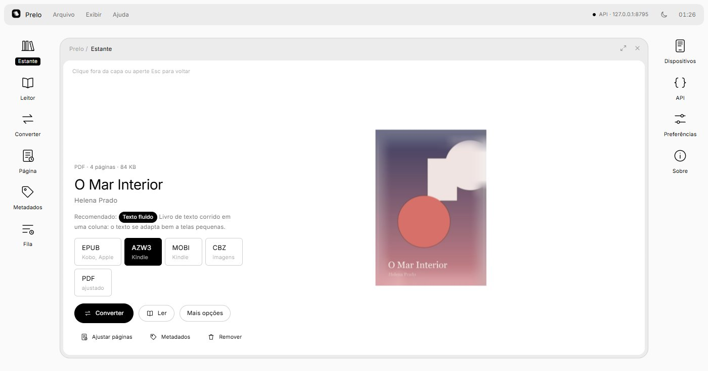
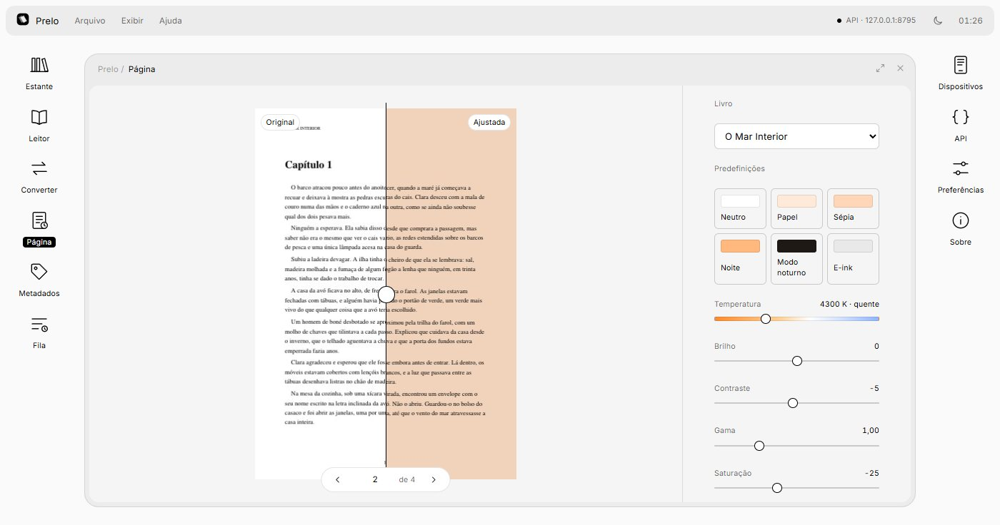

# Prelo

Conversor de livros que não quebra o layout, com um leitor embutido. PDF, EPUB, livros Kindle (AZW3/MOBI), quadrinhos e imagens viram EPUB, AZW3, MOBI, CBZ, PDF ou TXT: com as páginas idênticas ao original quando a diagramação importa, ou com o texto solto quando ele precisa se adaptar à tela do leitor.

Roda no **Windows** e no **Linux**, no seu computador: sem conta, sem nuvem e sem precisar do Calibre.

**[Baixar para Windows ou Linux](https://github.com/pdrza/prelo/releases/latest)** · [Instalação](#instalação) · [Como usar](#como-usar) · [Documentação](#documentação)



## O que ele faz

| Entrada | Saída | Observação |
|---|---|---|
| PDF | EPUB, AZW3, MOBI, CBZ, PDF, TXT | Uma análise automática escolhe entre layout fiel e texto fluido, e explica o motivo |
| EPUB (fluido ou de layout fixo) | EPUB, AZW3, MOBI, PDF, TXT, CBZ | |
| AZW3, MOBI, AZW, PRC (Kindle) | EPUB, AZW3, MOBI, PDF, TXT, CBZ | Lê a versão KF8, com CSS, fontes e imagens, ou o MOBI 6 |
| CBZ/ZIP de imagens, JPG, PNG, WebP | EPUB, AZW3, MOBI, CBZ, PDF | Lê o `ComicInfo.xml`; mangá da direita para a esquerda |

- **Dois modos para PDF.** No *layout fiel*, cada página é renderizada na resolução exata da tela do aparelho (Kindle Paperwhite, Kobo, tablet...), e colunas, tabelas, fórmulas e gráficos ficam como no original. No *texto fluido*, o texto é extraído e se adapta à tela: cabeçalhos e rodapés repetidos somem, palavras hifenizadas voltam a ser uma só, capítulos e tabelas são reconhecidos.
- **Ajustes de página.** Temperatura do papel (de 1900 K, cor de vela, a 10000 K), brilho, contraste, gama, saturação, nitidez e modo noturno, gravados no arquivo convertido. O editor mostra o antes e o depois lado a lado.
- **Leitor.** Lê no próprio app qualquer livro da estante, em qualquer um desses formatos. Livros de texto são paginados de novo para o tamanho da janela e a letra escolhida; PDF e quadrinhos mantêm a página original, com zoom. Tem sumário, temas (claro, papel, sépia e noite), duas páginas lado a lado e lembra onde você parou.
- **Kindle sem Calibre.** O AZW3 e o MOBI são gerados pelo próprio Prelo e passam no inspetor de MOBI do Calibre sem avisos. Se o Calibre estiver instalado, ele pode ser usado como motor alternativo.
- **Não estraga nada.** Nunca sobrescreve um arquivo (o novo ganha "(2)"), trabalha sobre uma cópia, roda cada conversão num processo separado e recusa livros com DRM.
- **Dá para automatizar.** Utilitários de linha de comando convertem pastas inteiras, mandam livros para o Kindle ou o Kobo ligado no USB e vigiam uma pasta. Por baixo de tudo há uma API HTTP local.



## Instalação

Cada versão traz os downloads dos dois sistemas na mesma página de [versões](https://github.com/pdrza/prelo/releases/latest). Baixe só o do seu:

| Sistema | Arquivo | O que é |
|---|---|---|
| Windows 10 ou 11 (64 bits) | `Prelo-VERSÃO-windows-x64-setup.exe` | instalador, o jeito mais simples |
| Windows 10 ou 11 (64 bits) | `Prelo-VERSÃO-windows-x64.zip` | versão portátil, sem instalar |
| Linux | `Prelo-VERSÃO-linux.tar.gz` | pacote com o instalador `install.sh` |

Não há versão para macOS.

### Windows

Não precisa de Python.

1. Baixe o `Prelo-VERSÃO-windows-x64-setup.exe`.
2. Abra o arquivo e avance. O Prelo é instalado só para o seu usuário, sem pedir senha de administrador.

O instalador não tem assinatura digital, então o Windows pode mostrar *"O Windows protegeu o computador"*. Clique em **Mais informações** e depois em **Executar assim mesmo**.

O instalador coloca o app em `%LOCALAPPDATA%\Programs\Prelo`, cria o atalho no menu Iniciar e põe o Prelo no *Abrir com* de PDF, EPUB, AZW3, MOBI e CBZ, sem virar o programa padrão. Se você deixar a opção marcada, os comandos `prelo`, `prelo-lote`, `prelo-enviar` e `prelo-vigiar` também passam a funcionar no terminal. Para desinstalar, use *Configurações › Aplicativos*; o desinstalador pergunta antes de apagar a sua estante.

Prefere não instalar? Baixe o `Prelo-VERSÃO-windows-x64.zip`, descompacte e abra o `prelo-app.exe`.

A janela usa o **Microsoft Edge WebView2 Runtime**, que já vem no Windows 11 e chega ao Windows 10 pelo Windows Update. Se ele faltar, o instalador oferece o download, e até lá o Prelo abre no navegador.

### Linux

Precisa do Python 3.11 ou mais novo, que já vem no Ubuntu 24.04, no Debian 12 e no Fedora. A janela usa o GTK 3 e o WebKitGTK 4.1 do sistema; o instalador confere e, se faltar algo, mostra o comando da sua distribuição (e só usa `sudo` se você confirmar).

Baixe o `Prelo-VERSÃO-linux.tar.gz` e, num terminal aberto na pasta do download, extraia e rode o instalador:

```bash
tar xzf Prelo-*-linux.tar.gz
cd Prelo-*/
./install.sh
```

O instalador baixa as bibliotecas do Prelo pela internet e põe tudo na sua pasta pessoal: o ambiente em `~/.local/share/prelo`, os comandos em `~/.local/bin` e o atalho no menu de aplicativos, com *Abrir com Prelo* para PDF, EPUB, AZW3, MOBI e CBZ. Depois disso, a pasta extraída pode ser apagada.

| Opção | Para quê |
|---|---|
| `./install.sh --qt` | janela com o Qt WebEngine instalado pelo pip, sem pacotes do sistema (~200 MB) |
| `./install.sh --sem-janela` | só a linha de comando e a API; a interface abre no navegador |
| `./install.sh --dev` | desenvolvimento: os comandos usam o código do repositório |
| `~/.local/share/prelo/uninstall.sh` | remove o Prelo; com `--tudo`, apaga também a estante e as preferências |

Se preferir instalar os pacotes do sistema antes: Ubuntu/Debian `sudo apt install python3-venv python3-gi gir1.2-webkit2-4.1`, Fedora `sudo dnf install python3-gobject webkit2gtk4.1`, Arch `sudo pacman -S python-gobject webkit2gtk-4.1`.

Para atualizar, baixe o pacote da versão nova e rode o `./install.sh` dele; a estante e as preferências continuam onde estavam. Quem preferir o Git pode instalar direto do código, com `git clone https://github.com/pdrza/prelo.git`, `cd prelo` e `./install.sh`, e atualizar com `git pull` e `./install.sh`.

## Como usar

### Aplicativo

Abra o **Prelo** pelo menu, rode `prelo-app` ou clique com o botão direito num livro e escolha *Abrir com Prelo*. Para adicionar livros, arraste os arquivos para a janela (do gerenciador de arquivos, do painel de downloads do navegador ou como link direto, que é baixado) ou use *Adicionar livros*. Pastas arrastadas são varridas atrás de livros.

Clique numa capa na estante, escolha o formato e clique em *Converter*. *Mais opções* abre o conversor completo (aparelho, modo, qualidade, cores, margens, texto) e *Ajustar páginas* abre o editor de temperatura e cores. O arquivo convertido fica ao lado do original, a menos que você escolha outra pasta nas preferências.



O Prelo abre uma janela só: abrir outro livro com ele manda o arquivo para a janela que já está aberta.

Atalhos: `Ctrl+O` adiciona livros, as setas giram a estante, `Esc` volta, `Shift+↑` expande a janela e `Shift+W` a fecha.

### Leitor

*Ler* abre o livro escolhido; depois da primeira leitura, o botão vira *Continuar* e mostra quanto você já leu. O ícone *Leitor* abre o livro selecionado na estante ou, se não houver um, o último que você leu.

| Tecla | O que faz |
|---|---|
| `→`, `←`, espaço, `PgDn`, `PgUp` | vira a página (num mangá, as setas seguem a direção dele) |
| `+` e `−` | letra maior ou menor; em PDF e quadrinhos, mais ou menos zoom |
| `T` | abre e fecha o sumário |
| `Home` e `End` | vai ao começo e ao fim |

Também dá para virar a página com a roda do mouse, com um clique na borda da página ou arrastando para o lado numa tela de toque. A posição fica guardada por livro, mesmo quando você muda a letra ou fecha o app. Livros Kindle levam alguns segundos na primeira abertura, porque o Prelo faz deles um EPUB para ler; depois abrem na hora.

### Utilitários

**`prelo-lote`** converte pastas inteiras. Lembra o que já converteu pelo conteúdo do arquivo, não pelo nome, então rodar de novo só converte os livros novos.

```bash
prelo-lote -f azw3 -p kindle-pw5 ~/Livros
prelo-lote -r -f epub -o ~/Convertidos ~/Downloads -- --mode fixed --temperature 4800
prelo-lote -n ~/Livros            # só mostra o que faria
```

**`prelo-enviar`** manda livros para o Kindle ou o Kobo ligado no USB. Descobre o aparelho, escolhe o formato que ele lê (AZW3 no Kindle, EPUB no Kobo), converte só o que precisa, não manda duas vezes o mesmo livro e pode ejetar no fim.

```bash
prelo-enviar livro.pdf
prelo-enviar -p kindle-scribe -m fixed -e revista.pdf manga.cbz    # layout fiel e ejeta no fim
prelo-enviar --listar                                              # leitores conectados
```

**`prelo-vigiar`** converte todo livro que cair numa pasta. Pode virar um serviço que liga sozinho: no Linux, um serviço do systemd do usuário; no Windows, a tarefa agendada *Prelo vigiar*.

```bash
prelo-vigiar -f azw3 ~/Livros/Entrada ~/Livros/Kindle
prelo-vigiar -f azw3 --instalar-servico ~/Livros/Entrada ~/Livros/Kindle
prelo-vigiar --remover-servico
```

Os três aceitam `--ajuda`, avisam no desktop quando terminam e funcionam igual no Windows, onde rodam no Prompt de Comando e no PowerShell (por exemplo, `prelo-lote -f azw3 D:\Livros`). No Windows, o `prelo-enviar` procura o leitor nas unidades removíveis (`E:\`, `F:\`...). Os registros do que já foi convertido e enviado são os mesmos nos dois sistemas.

### Linha de comando

```bash
prelo convert livro.pdf -f azw3 --profile kindle-pw5 --mode fixed --trim-margins uniform
prelo convert livro.pdf -f epub --mode reflow --temperature 4800
prelo convert livro.pdf -f azw3 --print-path       # imprime só o caminho do arquivo gerado
prelo inspect livro.pdf                            # metadados e qual modo o automático escolheria
prelo profiles                                     # aparelhos e resoluções
prelo options                                      # todas as opções
```

### API

```bash
prelo serve --port 8765            # mostra o token da sessão
```

A documentação interativa fica em `http://127.0.0.1:8765/api/docs`. A API escuta só em `127.0.0.1` e exige o token no cabeçalho `X-Prelo-Token`. Rotas, objetos, erros e exemplos com `curl` estão em [docs/api.md](docs/api.md).

## Como funciona

```
entrada (PDF, EPUB, Kindle, CBZ, imagem)
   │  detecta o formato pelo conteúdo · recusa DRM · trabalha numa cópia
   ▼
leitor ──► livro intermediário (layout fixo ou fluido) ──► transformações ──► escritor
             metadados · capítulos · páginas · recursos     metadados, sumário,    EPUB · AZW3 · MOBI
                                                            limpeza                CBZ · PDF · TXT
   ▼
gravação atômica, sem sobrescrever
```

Nenhum formato é convertido direto em outro: todo leitor monta o mesmo livro intermediário, e todo escritor parte dele. A arquitetura vem de um estudo do motor do Calibre; o que foi adotado, melhorado ou deixado de lado está em [docs/regras-do-calibre.md](docs/regras-do-calibre.md).

O app é uma janela nativa (pywebview: WebView2 no Windows, WebKitGTK no Linux) sobre uma API local em FastAPI, que sobe junto com ele em `127.0.0.1`. Não há banco de dados nem servidor externo: a estante e as preferências ficam em arquivos JSON em `~/.local/share/prelo` (no Windows, `%LOCALAPPDATA%\Prelo`).



## Documentação

| Documento | Conteúdo |
|---|---|
| [docs/conversao.md](docs/conversao.md) | as etapas de uma conversão, o livro intermediário, a análise automática do PDF e a prioridade das opções |
| [docs/formatos.md](docs/formatos.md) | o que entra, o que sai e como cada formato é tratado |
| [docs/opcoes.md](docs/opcoes.md) | todas as opções de conversão |
| [docs/dispositivos.md](docs/dispositivos.md) | aparelhos e resoluções |
| [docs/api.md](docs/api.md) | a API HTTP |
| [docs/regras-do-calibre.md](docs/regras-do-calibre.md) | o que veio do Calibre e o que mudou |

## Problemas comuns

**A interface abriu no navegador, e não numa janela.** Rode `prelo-app --diagnostico` (no Windows, `prelo app --diagnostico` no terminal): ele abre a janela, confere se a interface carregou e diz o que falta. No Linux, o caso mais comum é um ambiente virtual ativo no terminal, como o `(.venv)` que o VS Code ativa, que não enxerga o GTK do sistema: rode `deactivate` ou abra o Prelo pelo menu. No Windows, é a falta do WebView2 Runtime.

**Onde está o log?** Em `prelo.log`, na pasta de dados: `~/.local/share/prelo` no Linux e `%LOCALAPPDATA%\Prelo` no Windows. Os utilitários guardam o log em `~/.local/state/prelo/` no Linux e em `%LOCALAPPDATA%\Prelo\logs` no Windows.

**A capa não aparece na biblioteca do Kindle.** Alguns Kindles recentes não mostram a capa de livros copiados pelo cabo, por uma limitação do firmware com arquivos que não vieram da loja.

## Limitações

- DOCX, HTML, KFX e Topaz não são aceitos como entrada; o Prelo explica o motivo ao tentar adicionar. Livros com DRM são recusados.
- O texto fluido depende do texto do PDF: PDFs digitalizados sem OCR vão para o layout fiel.
- O `prelo-enviar` reconhece Kindle e Kobo. Leitores que se conectam por MTP, sem pasta montada nem letra de unidade (como alguns Kindles recentes), ficam de fora: converta com o `prelo-lote` e copie pelo gerenciador de arquivos.
- No leitor, o texto não pode ser selecionado nem pesquisado, porque as páginas chegam como imagem.

## Desenvolvimento

```bash
git clone https://github.com/pdrza/prelo.git
cd prelo
python3 -m venv --system-site-packages .venv   # enxerga o GTK do sistema (python3-gi)
.venv/bin/pip install -e ".[desktop,dev]"
.venv/bin/python -m pytest                     # com o Calibre instalado, também valida AZW3 e MOBI por ele
.venv/bin/prelo serve --local-paths --no-token # interface no navegador, sem a janela
```

No Windows, no PowerShell:

```powershell
winget install -e --id Python.Python.3.12      # se ainda não tiver o Python 3.11+
py -3.12 -m venv .venv
.venv\Scripts\pip install -e ".[desktop,dev]"
.venv\Scripts\python -m pytest                 # os utilitários são testados na versão PowerShell
.venv\Scripts\prelo app --diagnostico          # abre a janela, confere a interface e fecha
```

A documentação de opções, aparelhos, formatos e rotas sai do código: depois de mudar algum deles, rode `python tools/gerar_docs.py` (os testes conferem se ela está em dia).

### Gerar o instalador do Windows

```powershell
winget install -e --id JRSoftware.InnoSetup    # 6.3 ou mais novo
powershell -ExecutionPolicy Bypass -File windows\build.ps1 -Testar
```

O resultado fica em `dist\`: a pasta `windows\Prelo` (com `prelo-app.exe`, a janela, e `prelo.exe`, a linha de comando), o `.zip` portátil e o instalador. Sem o Inno Setup, saem só a pasta e o `.zip`. Com `-Testar`, o script confere a linha de comando, uma conversão em layout fiel e a janela.

### Publicar uma versão

1. Mude a versão em `pyproject.toml` e em `src/prelo/__init__.py`.
2. Crie e envie a tag: `git tag v0.3.1` e `git push origin v0.3.1`.
3. A CI roda os testes no Linux e no Windows, gera o instalador e o portátil do Windows e o pacote do Linux (que ela instala e testa como um usuário faria) e publica os três juntos na página de versões.

A publicação só acontece se tudo passar nos dois sistemas e a tag bater com a versão do código; se algo falhar, nada vai ao ar. Para tentar de novo depois de corrigir, apague a tag (`git tag -d v0.3.1` e `git push origin :v0.3.1`) e crie outra vez.

### Estrutura

```
src/prelo/
  core/      livro intermediário, opções, aparelhos, segurança, imagem, texto, pipeline,
             estante, leitor e integração com o sistema (Linux e Windows)
  inputs/    PDF (layout fiel e texto fluido), EPUB, Kindle, quadrinhos e imagens
  outputs/   EPUB 3, AZW3 (KF8), MOBI 6, CBZ, PDF e TXT
  api/       API em FastAPI e fila de conversões em processos separados
  app/       janela nativa (pywebview) e instância única
  ui/        interface (HTML, CSS e JavaScript; carrossel em Three.js)
bin/, lib/   utilitários em bash (Linux)
windows/     build.ps1, receitas do PyInstaller e do Inno Setup, utilitários em PowerShell
tests/       testes com livros de amostra gerados na hora
tools/       geradores da documentação e do ícone do Windows
docs/        documentação
```

## Licença

[AGPL-3.0](LICENSE), por causa do [PyMuPDF](https://pymupdf.readthedocs.io/), que também é AGPL. O acesso a PDFs fica isolado em `inputs/pdf*.py` e `inputs/render.py`, caso um dia valha trocar por uma biblioteca de licença permissiva.

Usa também Pillow, lxml, FastAPI, Uvicorn, pywebview, [Three.js](https://threejs.org/) (MIT) e a fonte [Inter](https://rsms.me/inter/) (OFL). No Windows, a janela usa o WebView2 da Microsoft pelo pythonnet, e a versão sem Python é montada com PyInstaller e Inno Setup. A mecânica da janela foi inspirada no site do PostHog; a paleta e o carrossel, no site do unveil.
